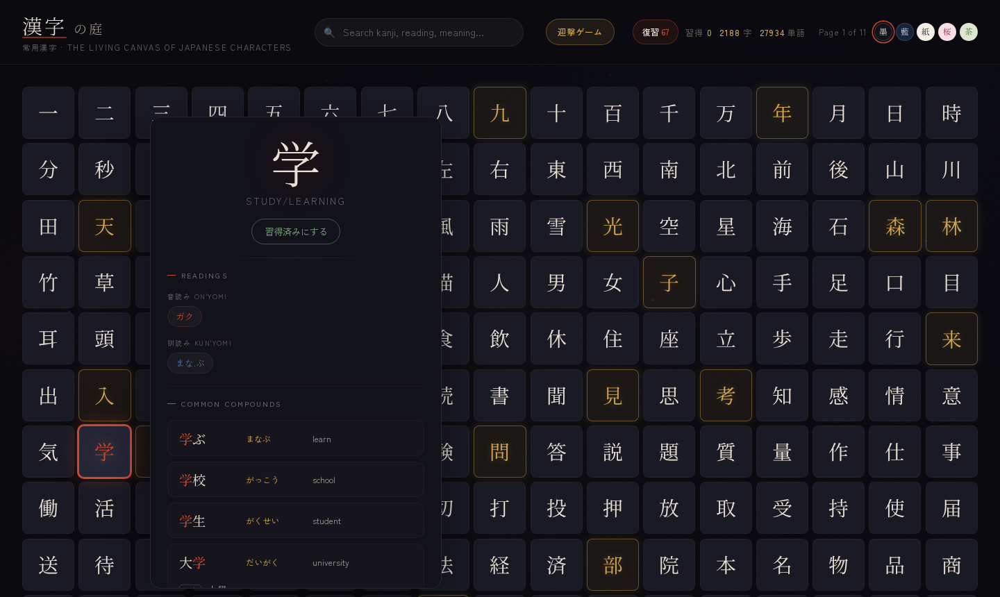
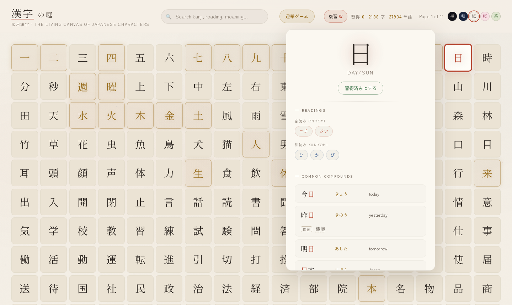
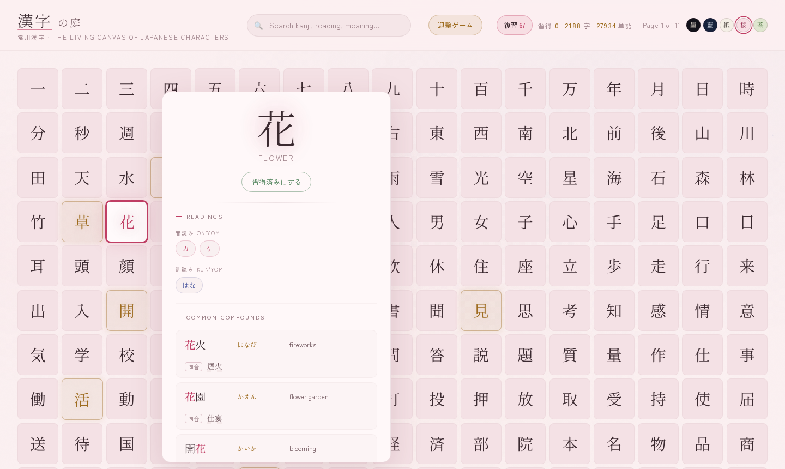
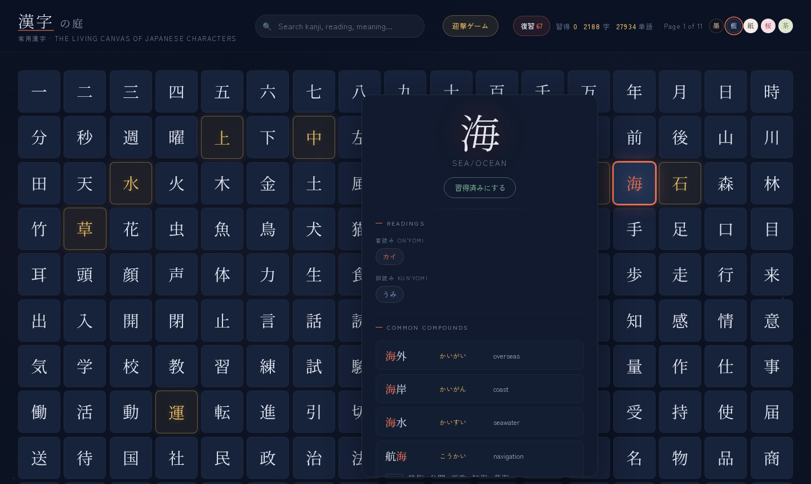
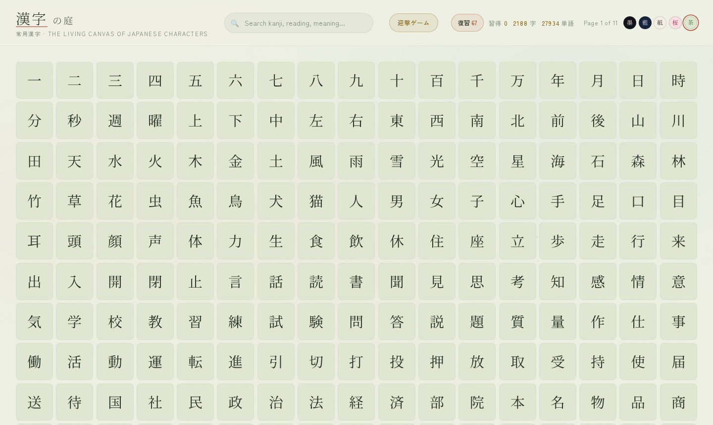
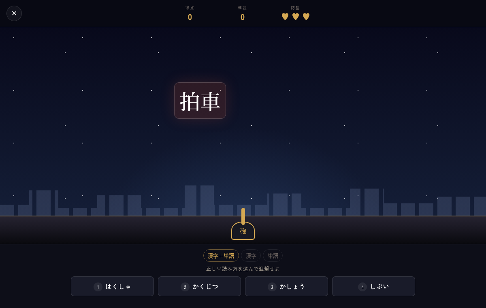
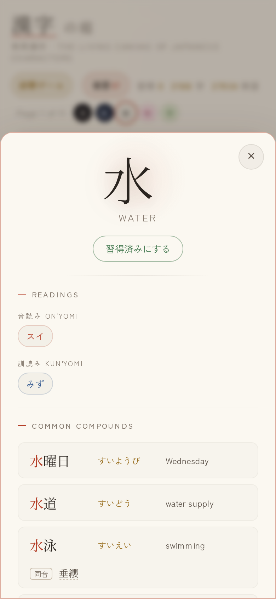

# 漢字の庭

ブラウザで漢字を探し、読み方を迎撃ゲームで練習できる静的 Web アプリです。



- **ホバーで詳細表示** — 漢字にマウスを乗せると、読み方・熟語・同音語・関連漢字をまとめたカードが横に開きます。クリックでカードを固定（`Esc` か外側のクリックで閉じる）。関連する漢字は一覧上で金色に光ります。
- **5 つのテーマ** — 右上のボタンで 墨（ダーク）・藍（ネイビー）・和紙（ライト）・桜・抹茶 を切り替えられます。選択はブラウザに保存され、初回は OS のライト／ダーク設定に従います。
- **迎撃ゲームと復習ノート** — 落ちてくる漢字・単語の正しい読みを選んで迎撃。間違えた問題は復習ノートに残ります。
- **スマートフォン対応** — タッチ端末ではタップで詳細が下からシート表示されます。

| 和紙 | 桜 |
|---|---|
|  |  |
| **藍** | **抹茶** |
|  |  |

| 迎撃ゲーム | スマートフォン |
|---|---|
|  |  |

## 起動

```bash
python3 -m http.server 8000
```

`http://localhost:8000` を開き、右上の「迎撃ゲーム」から遊べます。読み方はクリック、または `1`〜`4` キーで選択します。

間違えた問題と時間切れの問題は「復習」ノートに自動保存されます。ノートから錯題だけを再練習でき、各項目の削除または一括削除も可能です。錯題内の漢字をクリックすると、漢字一覧と同じ詳細パネルを開きます。

記録は二重に保存されます。ブラウザのローカルストレージ（即時表示とオフライン用）と、サーバーの `data/mistakes.json`（`/api/mistakes` 経由）です。サーバー側が正となるため、ブラウザを変えても、サーバーを再起動しても復習ノートは残ります。ページを開くとサーバーから読み込み、ローカルの記録と回数・日時をマージします。

ターミナルから直接の確認・削除もできます:

```bash
./run.sh review list
./run.sh review remove 'word:一つ:ひとつ'
./run.sh review clear
```

API のテスト:

```bash
python3 scripts/test_review_api.py
```

## オンライン収集

依存パッケージは不要です。Kanji API と Jisho の公開 API から常用漢字の読み方・意味・漢字語を取得し、既存項目を重複なしで増分更新します。保存時には一時ファイルから置換するため、中断時に JSON を壊しにくい構成です。

一回だけ収集:

```bash
python3 scripts/collect_online.py --batch 20 --new-kanji 3 --max-words 5
```

標準では、Jisho の `common` 語と短い語を優先し、各漢字の主要な音読み・訓読みを別々の単語で覆うように候補を選びます。訓読みは送り仮名から（例: `食` + `た.べる` → `食べる`）検索語を組み立てます。より多くの読みを一回で覆いたい場合:

```bash
python3 scripts/collect_online.py --batch 30 --new-kanji 10 --max-words 10 --max-word-length 6
```

各行の `reading coverage 4/5` と最後の集計は、その回に処理した漢字について、登録済み単語が何種類の読みを覆うかを示す近似値です。連濁・促音便などにより文字列だけでは判定できない読みもあるため、100%未満が必ずしもデータ欠落とは限りません。従来に近い検索順だけで追加する場合は `--no-coverage-first` を指定します。

処理済みの内容は漢字一字ごとに原子的に保存されます（`--checkpoint-every 1` が標準）。途中で `Ctrl+C` を押しても、失われる可能性があるのは現在取得中の一字だけです。再実行すると保存済みの JSON を読み込み、新しい漢字と未収録語を重複なしで追加します。ディスク書き込み回数を減らしたい場合のみ、例えば `--checkpoint-every 10` を指定できます。

1 時間ごとに継続収集:

```bash
python3 scripts/collect_online.py --interval 3600 --batch 20 --new-kanji 3 --max-words 5
```

推奨設定（30分ごと、30字を処理、常用漢字を10字ずつ追加）はラッパーから実行できます:

```bash
./update.sh
```

停止は `Ctrl+C` です。サイト公開前に変更内容を確認してから `data/kanji.json` をコミットしてください。API に接続できない取得先があっても、その回で取得できたデータは保存され、次回また試行します。
